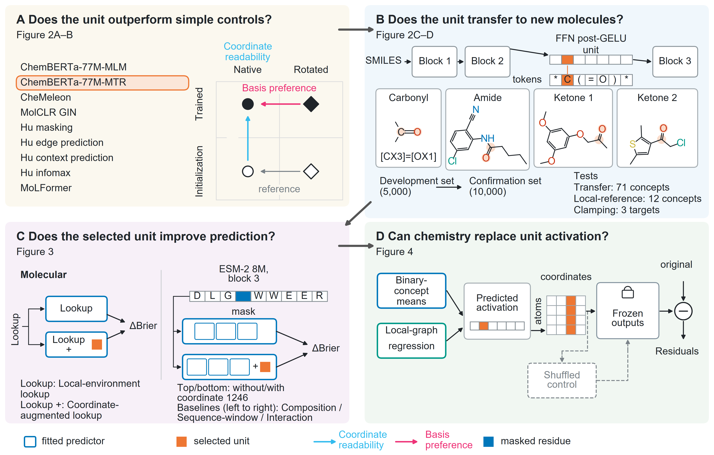

# Native chemical coordinates

Research companion for **Native Chemical Coordinates in Pretrained Molecular Models: Transfer, Local-Graph Reconstruction, and Output Preservation**.

The study addresses four questions: whether coordinate readability exceeds initialization and rotation references; whether development-selected coordinates transfer to held-out molecules; whether they improve prediction beyond explicit fitted references; and whether chemically reconstructed activations preserve frozen-network outputs. A separate ESM-2 analysis provides the protein extension.



Figure 1 is the exact image used in the manuscript, where orange highlights mark matched chemical query atoms rather than neural intervention sites.

## Scope

This companion provides analysis code, selected inputs, frozen derived results, and machine-readable figure data, while pretrained weights and bulk upstream databases are obtained from the original providers. The workflow documentation details the included materials, retrieval steps, and limits of computational reproduction.

The source data and workflow documentation preserve three methodological boundaries from the study: the eight-checkpoint molecular audit and the later MoLFormer gate have different design histories; the unseen-scaffold slice is a conditional analysis of the same confirmation cohort; and output interventions test model computation without establishing a biological mechanism or equivalence when intervals span zero.

## Start here

For a lightweight offline check, run from the repository root with Python 3.11 or later:

```sh
python scripts/lineB/companion.py smoke
```

This standard-library check reads frozen results to verify object coverage without loading a model or recomputing a scientific estimate.

| Material | Entry point | Included evidence |
| --- | --- | --- |
| Cross-model molecular audit | [CHEMISTRY_AUDIT.md](CHEMISTRY_AUDIT.md) | H4 structures and labels, 173-concept definitions, v5/v6 best-lift vectors, post hoc M1 and M4 results, gate summaries, source code and upstream asset inventory |
| D/T transfer, fitted references and chemical replacement | [WORKFLOWS.md](WORKFLOWS.md) | Selected molecular inputs, adopted analysis code, fixed fits and summaries, and archived original replacement outputs |
| Protein extension | [WORKFLOWS.md — protein replay](WORKFLOWS.md#executable-protein-replay) | All 116 replay inputs, frozen cohorts, saved activations and six fitted readout programs |
| Main and supporting figures | [FIGURES.md](FIGURES.md) | 15 final PNGs, frozen numerical data and available plotting sources |

The protein replay has a separate [requirements file](requirements-protein.txt), molecular work uses [requirements-chemistry.txt](requirements-chemistry.txt) and, for the legacy environment described in CHEMISTRY_AUDIT.md, [requirements-legacy.txt](requirements-legacy.txt), and figure rendering uses [requirements-figures.txt](requirements-figures.txt) for their respective workflows.

## Data sources and reproduction coverage

Molecular records come from PubChem, with selected H4 and historical exclusion records stored in `data/derived/lineB/` and selected D/T records in `data/revision_20261017/`. The [external-asset inventory](acquisition/EXTERNAL_ASSETS.json) logs the original upstream locations and available file identities, because the mutable bulk PubChem endpoint is not guaranteed to retain the original snapshot.

The protein input archive contains selected UniProt source snapshots and derived sequence/annotation records, attributed to the UniProt Consortium under CC BY 4.0, with retrieval, grouping, and replay scope documented in WORKFLOWS.md. Pretrained weights are not redistributed and are fetched from the named upstream sources through explicit acquisition scripts.

Large molecular activation caches and other intermediates outside this distribution are listed in the [omitted-input inventory](reproduction/OMITTED_INPUTS.json). Historical molecular runners keep their scientific guards and are supplied for method inspection and future reconstruction, as a complete molecular rerun from a clean installation has not been validated. Historical locks describe the original study and are not rebound to modified distribution files.

Validation of this distribution covers one [offline chemical coverage check](OFFLINE_SMOKE.json) and one [protein data/readout replay](reproduction/protein/VALIDATION.json). The protein replay passed 45 checks with a maximum score discrepancy of 4.66 × 10⁻¹⁵ under a 10⁻¹⁰ tolerance, running without network requests, encoder evaluations, fitting, or inferential resampling. Figure validation and its rendering limits are documented in FIGURES.md; these checks do not constitute independent scientific replication.

## Figures

See [figure reproduction and limits](FIGURES.md) for commands and per-figure coverage. The [figure manifest](figure_manifest.json) maps 4 main figures, 10 supporting figures, and the table-of-contents graphic to their frozen source data, with the final PNGs in [figures](figures/) and plotting code and saved graphical assets in [figure_source](figure_source/). Figure rendering plots existing results without repeating model inference or statistical estimation.

## Access and rights

The repository is publicly accessible without an access request. First-party code is released under the [MIT License](LICENSE), and first-party data, figures, and documentation under [CC BY 4.0](https://creativecommons.org/licenses/by/4.0/); see [Access and rights](RIGHTS.md) for third-party terms. These grants do not extend to upstream software, checkpoints, or data.
